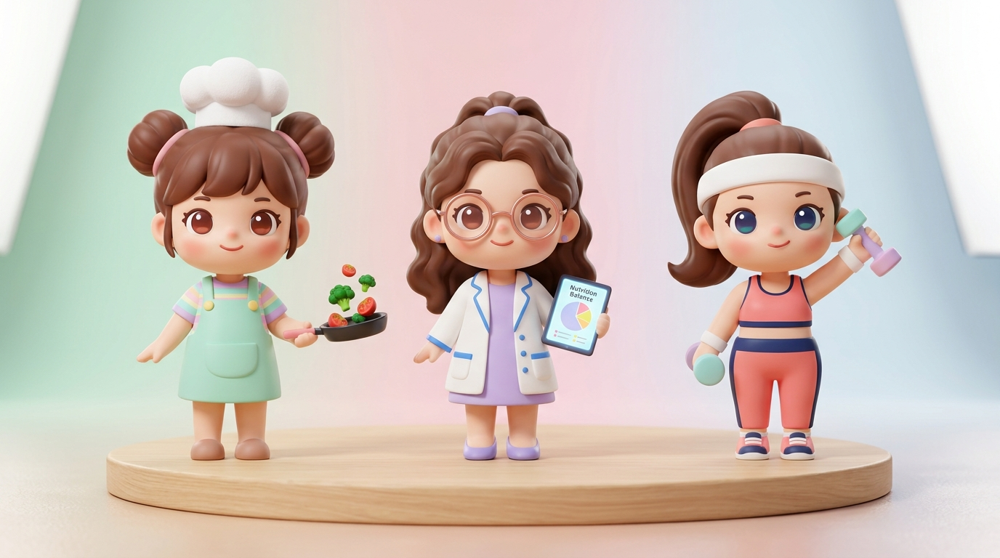

# 健管路上的神隊友 —— 3D Q版玩偶角色設定與設計規範書

> 專案主題：健管路上的神隊友（女性形象 / 3D Q版玩偶系列）  
> 設計宗旨：秉持健管 45 天核心金句——**「什麼事情都可以放下，唯獨不能放下筷子；什麼事情都可以失去，唯獨不能失去健康。」** 與 **「一個人走得快，一群人走得遠。」**，將健康管理歷程中的三大核心守護力量（備餐料理、科學營養、動態訓練）具象化為溫暖、療癒且具備專業感的 3D 潮流盲盒收藏公仔（Pop Mart 風格）。

---

## 🎨 總體視覺風格規範（Visual Style Guidelines）

1. **體態比例**：2.5 ～ 3 頭身萌系黃金比例（Chibi Collectible Figurine），兼具微肉感可愛身形與俐落職人精神。
2. **材質設定**：
   - **主體肌膚與服飾**：細膩親膚霧面搪膠（Matte Clay & Soft Vinyl），展現溫潤觸感。
   - **五官與點綴**：晶亮釉面圓眼、粉嫩漸層蘋果肌腮紅、微亮唇彩。
   - **手持微縮道具**：局部高光金屬漆、透明/半透明壓克力果凍樹脂、新鮮蔬果飽和彩度。
3. **場景與展示底座**：
   - 簡約圓形原木展示轉盤底座（Light Natural Wood Pedestal），帶有柔和自然的地面接觸陰影（Ground Contact Shadows）。
   - 背景採純淨柔和的三色粉彩漸層影棚（左側薄荷草本綠、中央薰衣草粉紫、右側晨曦晴空藍），與三位角色代表色呼應。

---

## 📸 定案概念草圖（Concept Draft Render）

- **圖檔路徑**：`generated/teammates_3d_dolls_concept_draft.jpg`
- **生圖規格**：Nano Banana Pro 原生 16:9 高細節 3D 玩偶棚拍攝影渲染。

---

## 👥 三大神隊友角色深度設定

### 👩‍🍳 1. 小廚師 —— 巧巧 (Chef Chiao)

> **座右銘金句**：  
> **「什麼都可以放下，唯獨不能放下筷子！吃飽吃好才有力氣瘦！」**

* **角色象徵**：廚房備餐神隊友、低卡原型食物魔法師。
* **真實原型對照**：致敬健管期間每日用心準備健康餐盤、無私同行的最佳戰友——雅雯（Carolyn）。
* **外觀造型**：
  * **髮型**：焦糖栗色微卷髮，梳成俏皮「雙丸子包包頭」。
  * **頭飾**：中央斜戴一頂蓬鬆純白的迷你蓬蓬廚師帽。
  * **五官表情**：溫暖大棕眼、充滿親和力的甜美微笑、粉嫩微紅雙頰。
  * **服裝**：內搭粉彩彩虹條紋短袖 T 恤，外穿**薄荷草本綠雙扣工作圍裙**（胸前帶口袋），腳踩圓頭料理小木鞋。
* **招牌手持配件**：
  * 左手平端一把黑色迷你平底煎鍋，鍋中呈現**立體漂浮、躍動翻炒中的鮮綠西蘭花與鮮紅小蕃茄**，傳遞「原型蔬菜美味又澎湃」的料理愉悅感。
* **識別色**：薄荷草本綠（`#86EFAC` / `#6EE7B7`）✕ 溫暖朝陽橘。

---

### 👩‍⚕️ 2. 營養師 —— 沛沛 (Dr. Pei)

> **座右銘金句**：  
> **「吃對營養素，代謝不打烊！每一口熱量都有大數據在背後撐腰！」**

* **角色象徵**：飲食科學導航員、熱量赤字與營養平衡精算大腦。
* **真實原型對照**：致敬全程每日線上餐盤把關、打破「少吃才會瘦」迷思、教導「吃對順序補足營養」的專業導航導師——沛璇老師。
* **外觀造型**：
  * **髮型**：深深巧克力棕大波浪微卷長髮，梳成知性半公主頭（扎著淡紫色髮圈）。
  * **配件**：配戴一副精緻的**玫瑰金細圓框半透明眼鏡**，眼神知性溫潤。
  * **五官表情**：專注親切的月牙笑眼、令人安心信賴的成熟笑容。
  * **服裝**：剪裁合身的短袖迷你白袍（俐落翻領與雙下擺口袋），內搭柔和優雅的**薰衣草紫連身裙**與同色圓頭包鞋。
* **招牌手持配件**：
  * 雙手拿著發光的**微縮智慧健康平板**，螢幕上清晰顯示**「營養平衡圓餅圖（Nutrition Balance）」**與健康指標打勾進度，象徵隨時守護宏量與微量營養均衡。
* **識別色**：知性薰衣草紫（`#C084FC` / `#DDD6FE`）✕ 純淨醫學白。

---

### 🏃‍♀️ 3. 健管教練 —— 麥麥 (Coach Mai)

> **座右銘金句**：  
> **「動起來超好玩！今天多累積的心跳，明天都會變成燃脂代謝力！」**

* **角色象徵**：熱血能量發電機、增肌減脂動力引擎與體態雕塑指導。
* **真實原型對照**：致敬用熱情活力全程激勵、指導日常活動量與燃脂訓練的導師——淑媛教練（麥淑媛教練）。
* **外觀造型**：
  * **髮型**：動感俐落的側邊高馬尾，隨步伐甩動散發無窮活力。
  * **頭飾**：額頭戴著一條純白運動吸汗寬髮帶。
  * **五官表情**：湛藍深邃的大眼、充滿感染力的大方燦爛笑容。
  * **服裝**：專業運動機能穿搭——**活力珊瑚粉 ✕ 深海軍藍撞色**運動內衣背心、高腰壓縮訓練緊身褲、純白運動護腕與粉藍拼色迷你緩震氣墊球鞋。
* **招牌手持配件**：
  * 雙手分別握著可愛的**馬卡龍粉藍雙色輕量小啞鈴**，左臂向上高舉比出激勵手勢，展現「健康不用苦練，有動就加分」的熱血運動魂。
* **識別色**：熱血珊瑚粉（`#FB7185` / `#FDA4AF`）✕ 活力深海軍藍（`#1E3A8A`）。

---

## 🚀 後續應用場景延伸

1. **成果分享簡報 PPTX 融入**：
   - 可作為第 4 頁 / 第 5 頁【第四幕・試煉與盟友】之象徵插圖，與雅雯、沛璇、淑媛教練的感謝講稿完美呼應。
2. **社群與維持期指南打卡素材**：
   - 巧巧負責發布「減脂食譜與備餐教學」。
   - 沛沛負責發布「外食避坑指南與營養補給卡」。
   - 麥麥負責發布「辦公室伸展與 1000 步破風打卡」。
3. **衍生周邊/表情包**：
   - 可後續延伸為「九宮格日常打卡表情包」（喝水提醒、量體重、吃大餐前、運動達標）。
